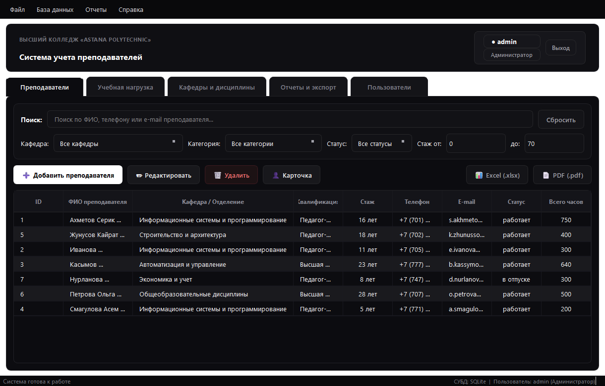
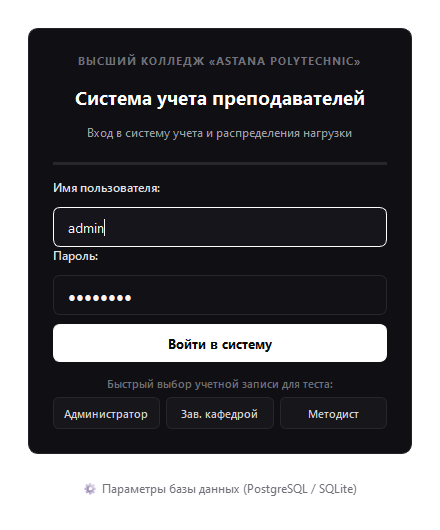
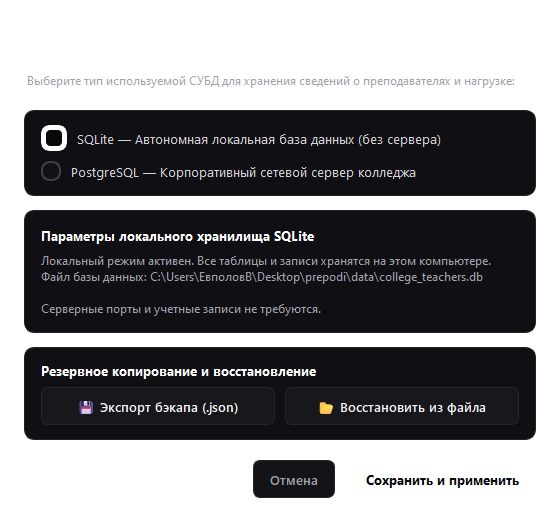
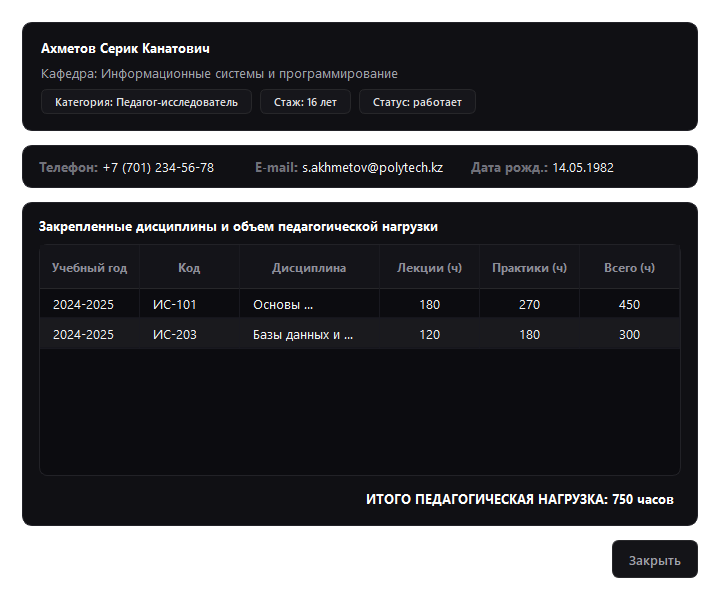
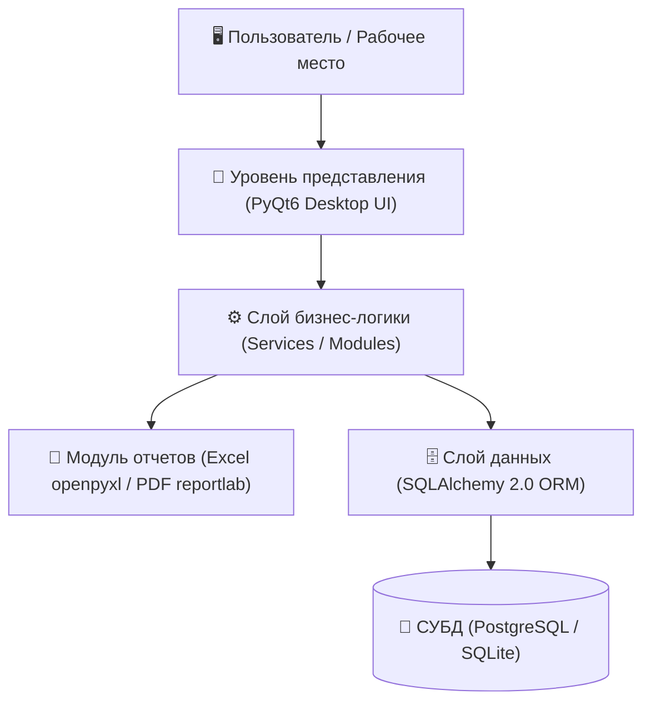
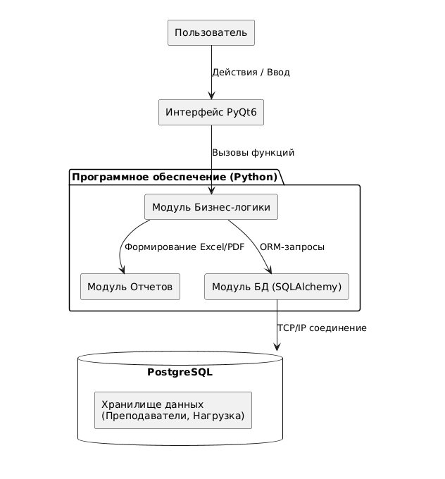
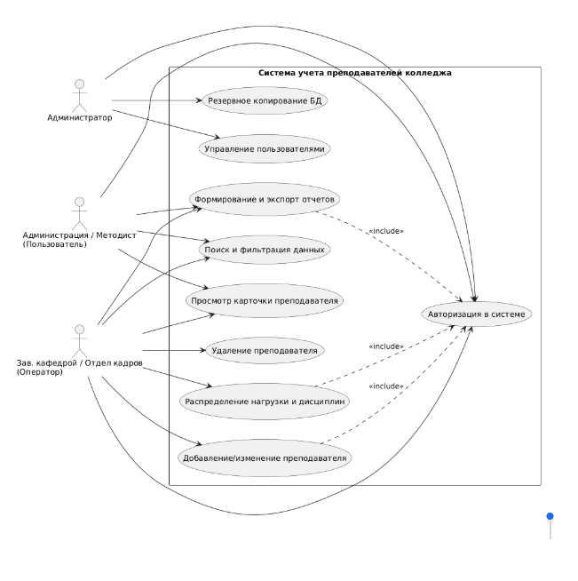
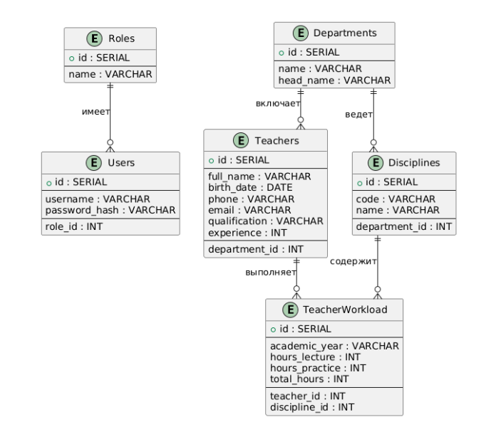
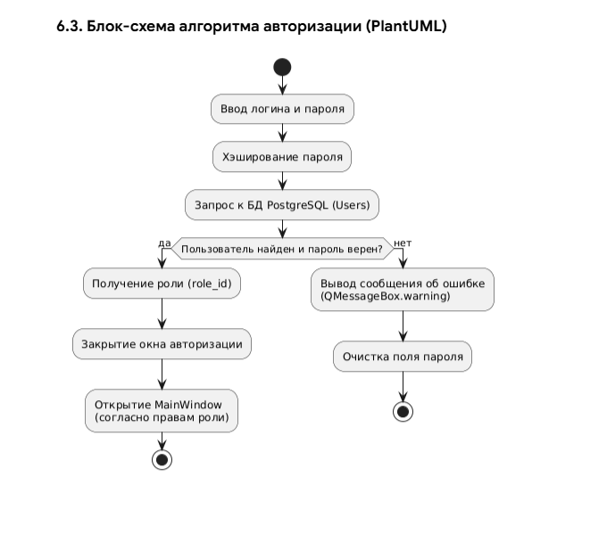

<div align="center">

# 🎓 АСУ «Учет преподавателей и учебной нагрузки»
### Высший колледж «Astana Polytechnic»

<p align="center">
  <b>Современная автоматизированная информационная система кадрового учета преподавательского состава и контроля распределения учебной нагрузки</b>
</p>

[](https://www.python.org/)
[](https://riverbankcomputing.com/software/pyqt/)
[](https://www.sqlalchemy.org/)
[](https://www.postgresql.org/)
[](https://www.sqlite.org/)
[](https://tunecloud.skippingclass.xyz/)

---

[🚀 Быстрый старт](#-быстрый-старт) • [✨ Ключевые возможности](#-ключевые-возможности) • [🖼 Скриншоты системы](#-скриншоты-интерфейса) • [📐 Архитектура и диаграммы](#-системная-архитектура-и-диаграммы) • [🔑 Учетные записи](#-ролевая-модель-и-тестовые-аккаунты) • [📁 Структура проекта](#-структура-репозитория)

---

</div>

## 📌 О проекте

Программный комплекс разработан в рамках курсового проектирования для **Высшего колледжа «Astana Polytechnic»**. 
Система автоматизирует полный жизненный цикл учета преподавателей, закрепления учебных дисциплин за кафедрами, ведения учебной нагрузки (лекционные и практические часы), а также мгновенного формирования аналитических ведомостей с экспортом в **Excel (.xlsx)** и **PDF (.pdf)**.

### 🖤 TuneCloud Monochrome UI
Интерфейс спроектирован в топовой темной монохромной эстетике сервиса [TuneCloud](https://tunecloud.skippingclass.xyz/): глубокий матовый графит (`#09090b`), мягкие карточные контейнеры (`#121216`), контрастные белые кнопки действий, адаптивные таблицы с подсветкой и кастомные элементы управления.

---

## 🖼 Скриншоты интерфейса

<div align="center">

### Главное рабочее окно (MainWindow — Кадровый состав)


<table>
  <tr>
    <td align="center"><b>Окно авторизации и быстрый выбор ролей</b></td>
    <td align="center"><b>Параметры СУБД (PostgreSQL / SQLite) и Бэкап</b></td>
  </tr>
  <tr>
    <td></td>
    <td></td>
  </tr>
  <tr>
    <td colspan="2" align="center"><b>Личная карточка преподавателя со сводкой часов</b></td>
  </tr>
  <tr>
    <td colspan="2" align="center"></td>
  </tr>
</table>

</div>

---

## ✨ Ключевые возможности

| Модуль | Возможности и функционал |
| :--- | :--- |
| **Кадровый учет (`TeacherModule`)** | • Добавление, редактирование, просмотр и удаление карточек преподавателей.<br>• Многокритериальный живой поиск (по ФИО, телефону, e-mail).<br>• Фильтрация по кафедрам, педагогическим категориям и трудовому стажу.<br>• Контроль корректности контактных данных и валидация ввода. |
| **Учебная нагрузка (`WorkloadModule`)** | • Распределение дисциплин по учебным годам (2023–2024, 2024–2025, 2025–2026).<br>• Раздельный учет лекционных и практических часов с автоподсчетом итога.<br>• Защита от дублирования назначения одной дисциплины преподавателю в рамках года.<br>• Оперативная сводка общей академической нагрузки по колледжу. |
| **Кафедры и дисциплины (`DepartmentModule`)** | • Управление кафедрами/отделениями колледжа и закрепление заведующих.<br>• Реестр дисциплин с уникальными академическими шифрами и привязкой к кафедрам.<br>• Защита целостности данных (блокировка удаления кафедр с активными кадрами). |
| **Аналитика и отчетность (`ReportModule`)** | • Формирование сводного кадрового отчета по отделениям.<br>• Ведомость распределения учебной нагрузки преподавателей.<br>• Сводная статистическая матрица категорий педагогического мастерства.<br>• **Экспорт в Microsoft Excel (`.xlsx`)** с автоформатированием колонок и формулами.<br>• **Экспорт в Adobe PDF (`.pdf`)** с альбомной ориентацией и поддержкой кириллицы. |
| **Безопасность и администрирование (`UserModule`)** | • Ролевое разграничение доступа (RBAC: Администратор, Зав. кафедрой, Методист).<br>• Криптографическое хэширование паролей алгоритмом **SHA-256**.<br>• Защита от удаления последнего администратора и собственной учетной записи.<br>• Экспорт и импорт полной базы данных в **JSON-резервную копию**. |
| **Двухрежимная СУБД (`Dual-Engine`)** | • **SQLite**: Автономный локальный запуск «из коробки» без внешних серверов.<br>• **PostgreSQL**: Корпоративный режим для локальной сети колледжа с пулом соединений. |

---

## 📐 Системная архитектура и диаграммы

Программный комплекс строго следует диаграммам курсовой записки:

### 1. Архитектурная трехуровневая схема (3-Tier Architecture)

<p align="center">
  
</p>

---

### 2. Диаграмма прецедентов (Use Case Diagram)
Отражает разграничение зон ответственности между ролями пользователей:
<p align="center">
  
</p>

---

### 3. ER-диаграмма сущностей базы данных (Entity-Relationship)
Включает 6 нормализованных сущностей (3NF):
<p align="center">
  
</p>

---

### 4. Алгоритм сквозной авторизации (Auth Flowchart)
Процесс проверки прав пользователя и разграничения доступа к функциям:
<p align="center">
  
</p>

---

## 🔑 Ролевая модель и тестовые аккаунты

При запуске в окне входа доступны кнопки **быстрого заполнения** для мгновенного входа под нужной ролью:

| Роль | Логин | Пароль | Доступные функции и права |
| :--- | :--- | :--- | :--- |
| **🛡️ Администратор** | `admin` | `admin123` | **Полный доступ**: Управление пользователями, создание/восстановление резервных копий БД, редактирование всех таблиц, кафедр, преподавателей и отчетов. |
| **📋 Заведующий кафедрой / Отдел кадров** | `operator` | `operator123` | **Операторский доступ**: Добавление, изменение и удаление преподавателей, распределение учебных часов и дисциплин, карточки кадров, выгрузка отчетов. |
| **📊 Методист / Руководство** | `methodist` | `methodist123` | **Аналитический доступ (Read-Only)**: Просмотр преподавателей и нагрузок, фильтрация, карточки преподавателей, экспорт отчетов в Excel и PDF. Кнопки изменения заблокированы. |

---

## 🚀 Быстрый старт

### Требования
* Операционная система: **Windows 10 / 11**, macOS или Linux
* **Python 3.10+** (рекомендуется Python 3.12)

### Способ 1: Запуск в один клик (Windows)
Просто запустите файл **`run.bat`** двойным щелчком мыши:
```cmd
run.bat
```
*(Скрипт автоматически найдет установленный Python и запустит интерфейс).*

### Способ 2: Запуск из терминала
1. **Клонируйте репозиторий**:
   ```bash
   git clone https://github.com/skippingclass/kursovaya.git
   cd kursovaya
   ```

2. **Создайте и активируйте виртуальное окружение** (рекомендуется):
   ```bash
   python -m venv venv
   # Windows:
   venv\Scripts\activate
   # Linux / macOS:
   source venv/bin/activate
   ```

3. **Установите зависимости**:
   ```bash
   pip install -r requirements.txt
   ```

4. **Запустите систему**:
   ```bash
   python run.py
   ```
*(При первом старте система автоматически создаст локальную базу данных `data/college_teachers.db` и наполнит ее начальными демо-данными преподавателей и кафедр).*

---

## ⚙️ Переключение на PostgreSQL

Для использования корпоративной сетевой базы данных:
1. В окне авторизации нажмите ссылку **«Параметры СУБД»** (или в меню *«База данных -> Параметры подключения»*).
2. Переключите радиокнопку на **«PostgreSQL — Корпоративный сетевой сервер колледжа»**.
3. Заполните реквизиты подключения:
   - **Хост**: `localhost` или IP-адрес сервера
   - **Порт**: `5432`
   - **Имя БД**: `college_teachers`
   - **Пользователь**: `postgres`
   - **Пароль**: ваш пароль СУБД
4. Нажмите кнопку **«🔍 Проверить соединение с PostgreSQL»**.
5. Нажмите **«Сохранить и применить»**. Система автоматически создаст всю структуру таблиц и заполнит справочники.

---

## 📁 Структура репозитория

```text
kursovaya/
├── .gitignore                    # Исключения версионного контроля
├── README.md                     # Документация проекта
├── requirements.txt              # Список библиотек (PyQt6, SQLAlchemy, openpyxl, reportlab, psycopg2)
├── run.bat                       # Быстрый запуск для Windows
├── run.py                        # Главная точка входа приложения
├── config.py                     # Глобальные параметры, роли, пути и настройки подключения
├── data/                         # Каталог локальной БД SQLite
│   └── college_teachers.db       # Автономный файл базы данных с демо-данными
├── database/                     # Слой доступа к данным
│   ├── __init__.py
│   ├── models.py                 # ORM-модели (Role, User, Department, Discipline, Teacher, TeacherWorkload)
│   ├── connection.py             # Движок подключения, пул сессий и инициализация БД
│   ├── seed_data.py              # Первоначальный посев демо-данных «Astana Polytechnic»
│   └── backup.py                 # Модуль полного резервного копирования и восстановления в JSON
├── services/                     # Слой бизнес-логики приложения
│   ├── __init__.py
│   ├── auth_service.py           # Хэширование SHA-256, аутентификация и проверка прав (RBAC)
│   ├── teacher_service.py        # Управление кадрами, валидация и многокритериальный поиск
│   ├── workload_service.py       # Расчет часов нагрузки, проверка дубликатов
│   ├── department_service.py     # Справочники отделений и дисциплин
│   ├── user_service.py           # Администрирование пользователей и смена паролей
│   └── report_service.py         # Генерация отчетов Excel (.xlsx) и PDF (.pdf)
├── ui/                           # Пользовательский графический интерфейс (PyQt6)
│   ├── __init__.py
│   ├── styles.py                 # Топ-монохромный дизайн в эстетике TuneCloud
│   ├── login_window.py           # Окно авторизации с быстрым выбором ролей
│   ├── main_window.py            # Главное окно: меню, вкладки, баннер и статус-бар
│   ├── teacher_tab.py            # Вкладка преподавательского состава
│   ├── teacher_dialog.py         # Модальное окно добавления/редактирования преподавателя
│   ├── teacher_card_dialog.py    # Личная карточка преподавателя со сводкой часов
│   ├── workload_tab.py           # Вкладка распределения учебной нагрузки
│   ├── workload_dialog.py        # Модальное окно назначения учебных часов
│   ├── departments_tab.py        # Вкладка кафедр и учебных дисциплин
│   ├── reports_tab.py            # Аналитические отчеты и экспорт документов
│   ├── users_tab.py              # Панель управления пользователями (для Администратора)
│   └── db_settings_dialog.py     # Модальное окно параметров СУБД и резервного копирования
└── docs/                         # Документация и медиа-материалы
    ├── diagrams/                 # Исходные диаграммы курсовой работы (PlantUML)
    │   ├── architecture.png      # Трехуровневая архитектура системы
    │   ├── use_case.png          # Диаграмма вариантов использования
    │   ├── erd.png               # ER-диаграмма реляционной базы данных
    │   └── auth_flowchart.png    # Блок-схема авторизации пользователей
    └── screenshots/              # Скриншоты реального интерфейса TuneCloud UI
        ├── login_window.png
        ├── db_settings.png
        ├── main_window.png
        └── teacher_card.png
```

---

## 🛠 Технологический стек

* **Язык разработки**: Python 3.12 (Strongly Typed, PEP 8)
* **Графический фреймворк**: PyQt6 (Qt 6.12+)
* **Слой хранения данных (ORM)**: SQLAlchemy 2.0 (Declarative Base, Unit of Work, Sessionmaker)
* **СУБД**: PostgreSQL 14+ / SQLite 3
* **Драйвер PostgreSQL**: psycopg2-binary
* **Генерация таблиц Excel**: openpyxl
* **Генерация документов PDF**: reportlab (с поддержкой TrueType шрифтов Windows)
* **Контроль версий**: Git & GitHub CLI

---

<div align="center">

### Разработано для Высшего колледжа «Astana Polytechnic» 🏛️
**TuneCloud Monochrome Dark Theme • 2026**

</div>
