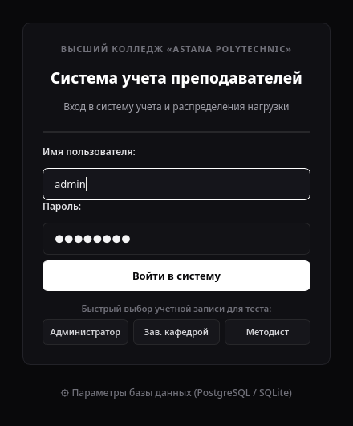
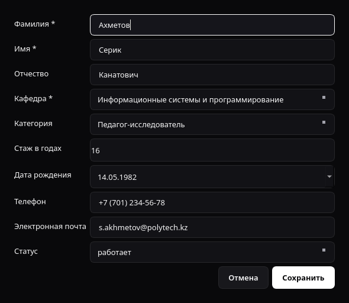
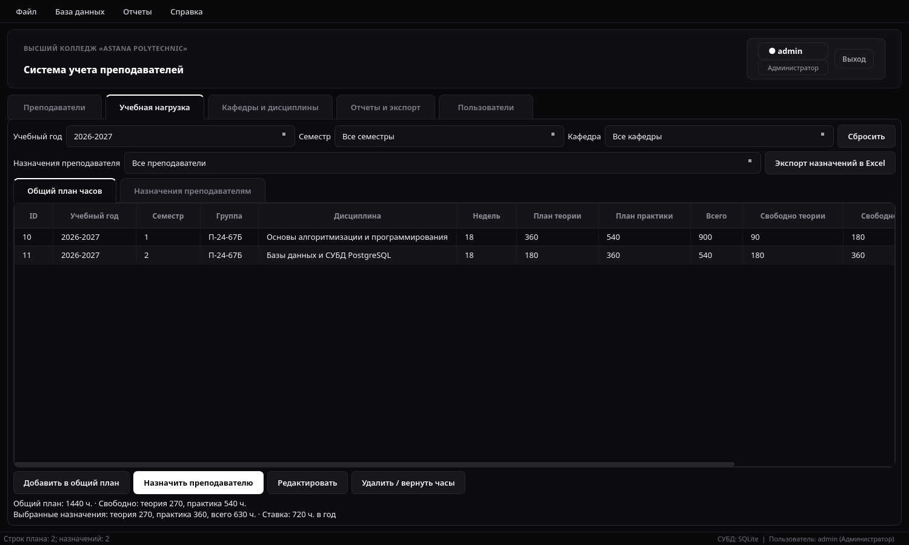
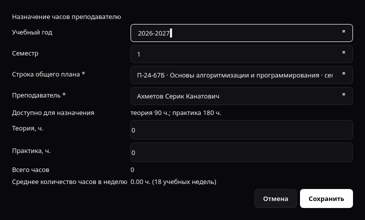
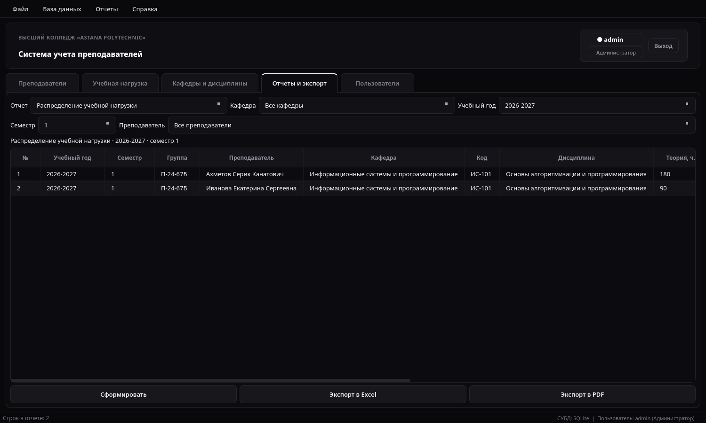

# Руководство пользователя

Высший колледж «ASTANA POLYTECHNIC»

Евполов Владислав, группа П-24-67Б. GitHub skippingclass. Версия 2.0.

## 1 Назначение и запуск

Программа учитывает преподавателей и распределяет теоретические и практические часы из общего плана. Сначала заполняются справочники и карточки, затем создается план и назначаются часы преподавателям.

Для запуска нужен Python 3.10 или новее. В каталоге проекта выполните python -m venv .venv, активируйте окружение и выполните python -m pip install -r requirements.txt, затем python run.py. В Windows доступен run.bat. Локальная SQLite не требует отдельного сервера.

При первом запуске создаются демонстрационные записи. Администратор входит как admin / admin123, заведующий кафедрой — operator / operator123, методист — methodist / methodist123. Перед использованием реальных данных администратор должен сменить демонстрационные пароли.

Администратор управляет пользователями и копиями. Заведующий кафедрой изменяет карточки, справочники и нагрузку. Методист просматривает данные и экспортирует отчеты; кнопки изменения для него скрыты.

## 2 Преподаватели

На вкладке «Преподаватели» нажмите «Добавить преподавателя». Заполните фамилию и имя раздельно, отчество при наличии. Выберите кафедру, категорию, стаж и статус. Контакты и дата рождения необязательны, но заполненные значения должны быть корректными.

Телефон вводится по маске +7 (999) 999-99-99. Введите все десять цифр после +7 либо очистите поле. Почта имеет формат name@example.kz. Стаж допускается от 0 до 70 лет.

Тот же ФИО, телефон или e-mail блокирует повторное сохранение. При похожем ФИО проверьте опечатку. Ответ «Да» допускается, если это другой человек; ответ «Нет» возвращает к исправлению формы.

Для изменения выберите строку и нажмите «Редактировать». «Карточка» открывает нагрузку по году и семестру. Поиск не учитывает регистр кириллицы. Выберите сортировку по ФИО, стажу, кафедре или часам и ее направление. Фильтр ставки считает 720 часов за выбранный учебный год.

## 3 Общий план

Откройте «Учебная нагрузка» и «Общий план часов», нажмите «Добавить в общий план». Укажите год в формате 2026-2027, семестр 1 либо 2, группу, дисциплину и число учебных недель. Введите общий объем теории и практики для группы за семестр.

Учебный пример для П-24-67Б по программированию — первый семестр 2026-2027 года, 360 часов теории и 540 практики, 18 недель. Общий объем составляет 900 часов. Замените эти значения фактическим планом колледжа.

Таблица показывает плановые и свободные часы. Повторное сочетание года, семестра, группы и дисциплины не допускается. Для изменения выберите строку и нажмите «Редактировать». Нельзя уменьшить план ниже назначенного объема или удалить его с действующими назначениями. Перед сменой дисциплины отмените назначения.

## 4 Назначение и возврат часов

Выберите строку плана и нажмите «Назначить преподавателю». Проверьте год, семестр и план, выберите преподавателя и часы теории и практики. Доступный остаток отображается над полями.

Если из плана 360/540 назначить первому преподавателю 180/180, останется 180/360. После назначения второму 90/180 свободно 90/180. Среднее число часов в неделю для первого назначения равно 360 / 18 = 20. Это средний показатель, а не расписание.

Для возврата части часов на странице «Назначения преподавателям» выберите запись и уменьшите ее объем. Для возврата всех часов используйте «Удалить / вернуть часы». Чтобы передать объем другому преподавателю, измените преподавателя в форме.

Для переноса в другой план измените год, семестр и строку плана. Успешное сохранение освобождает старый план и уменьшает новый. Если нового остатка недостаточно, прежнее назначение сохраняется.

При нехватке часов уменьшите соответствующий вид занятий либо уточните общий план. Свободная практика не заменяет теорию. Если назначение из выбранного плана у преподавателя уже есть, отредактируйте существующее.

## 5 Выборки и экспорт

На вкладке нагрузки выберите год, семестр, кафедру и преподавателя. Последний фильтр изменяет назначения; общий план продолжает показывать строки всей выбранной кафедры за период. В личной карточке также доступны год и семестр.

На вкладке «Отчеты и экспорт» выберите кадровый отчет, ведомость нагрузки либо статистику. Для ведомости задайте год, семестр и преподавателя, сформируйте таблицу и сохраните Excel либо PDF.

Экспорт учитывает параметры предпросмотра. Ведомость содержит год, семестр, группу, преподавателя, дисциплину, теорию, практику, итог и часы в неделю. Excel на вкладке нагрузки также учитывает выбранного преподавателя.

Фильтр «Не указан (архив)» показывает прежние назначения с неизвестным семестром. Уточните семестр, группу и число недель архивного плана перед подготовкой итоговых документов.

## 6 Копии и сообщения

Администратор создает JSON-копию через меню «База данных». Она включает семь таблиц. Для восстановления выберите копию и подтвердите замену данных. Ошибочные связи или превышение плана отменяют восстановление с сохранением прежнего состояния.

При первом открытии старой SQLite-базы создается .before-v2.bak. Старые назначения сохраняются в архиве. До уточнения число недель равно 18, поэтому недельные показатели архива требуют проверки.

Похожая карточка требует проверки ФИО. Дубликат плана означает, что строка уже существует. Отказ сократить план требует сначала уменьшить назначения. При ошибке подключения проверьте тип базы, сервер и реквизиты.

Руководства открываются из меню «Справка». В окне «О программе» указаны Евполов Владислав, П-24-67Б, Высший колледж «ASTANA POLYTECHNIC» и GitHub skippingclass.
