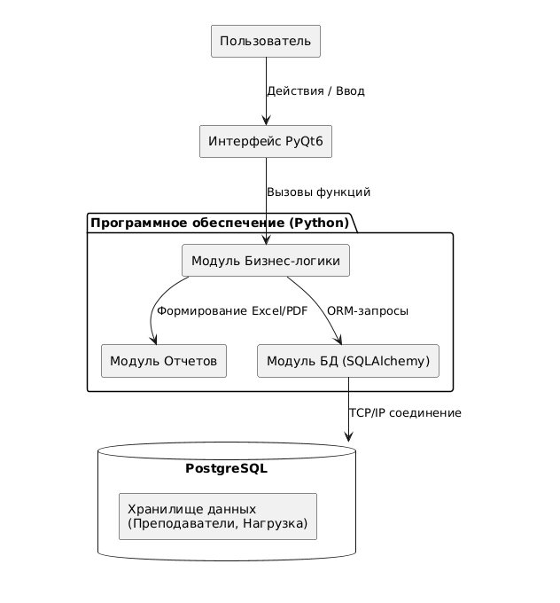
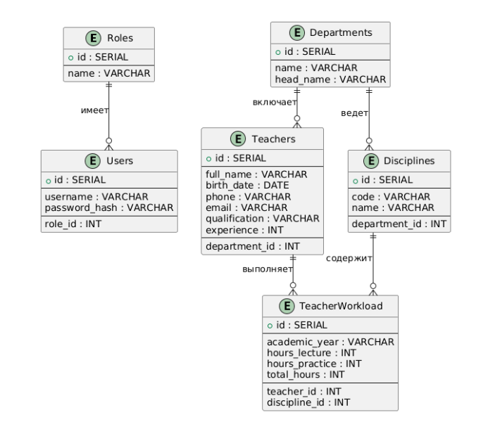

# Руководство разработчика

Высший колледж «ASTANA POLYTECHNIC»

Евполов Владислав, группа П-24-67Б. GitHub skippingclass. Версия 2.1.

## 1 Назначение и установка

Проект — настольная система кадрового учета и распределения нагрузки. Уровни программы расположены в ui, services и database. Запуск требует Python 3.10 или новее и requirements.txt. Для Word-документов и проверки экспорта установите также requirements-dev.txt.

Создайте окружение python -m venv .venv, активируйте его, выполните python -m pip install -r requirements-dev.txt и python run.py. Для локальной работы используется SQLite. Параметры находятся в settings.json, локальные данные — в data/college_teachers.db.

PostgreSQL выбирается в диалоге подключения. Сервер, база и права на создание таблиц подготавливаются отдельно. Встроенный локальный снимок старой базы относится только к SQLite.

## 2 Модули и архитектура

config.py содержит константы и чтение настроек, run.py — запуск Qt и базы. models.py определяет семь моделей, connection.py — движок и инициализацию, migrations.py — совместимость старой схемы, backup.py — JSON-копии.

teacher_service.py выполняет нормализацию, проверку карточек, поиск, сравнение похожих записей и сортировку. workload_service.py управляет планом и транзакциями распределения. report_service.py предоставляет единые наборы данных для предпросмотра и форматов выгрузки.

TeacherDialog содержит раздельные ФИО. PoolDialog и WorkloadDialog — общий план и назначения. WorkloadTab показывает две таблицы, ReportsTab передает одинаковые фильтры предпросмотру и экспорту. MainWindow объединяет вкладки и открывает руководства из docs.

Сервисы возвращают статус и сообщение. Формы не должны записывать ORM-объекты напрямую, поскольку проверки остатков, дубликатов и синхронизация периода находятся в сервисах.

## 3 Данные и транзакции

Модели — Role, User, Department, Teacher, Discipline, WorkloadPool и TeacherWorkload. Команда python scripts/export_schema.py сохраняет фактические поля в docs/schema.json. Строка плана определяется дисциплиной, группой, годом и семестром.

Остаток каждого вида часов вычисляется как план минус сумма назначений. Отдельный счетчик остатка не хранится. Поэтому отмена назначения освобождает часы через удаление записи распределения.

Уникальны год + семестр + группа + дисциплина и pool_id + teacher_id. Год, семестр и дисциплина назначения копируются из плана и синхронизируются при изменении периода. Проверка остатка выполняется внутри транзакции.

SQLite использует BEGIN IMMEDIATE, PostgreSQL — FOR UPDATE. Перенос блокирует оба плана в порядке ID. Нельзя заменять проверку внутри транзакции проверкой только в форме.

Модуль server/api.py проверяет роли, валидирует запросы и передает их в сервисы. Вход выдает сессию на один час. Пароли хранятся в формате scrypt с солью. Записи SHA-256 обновляются после успешного входа. Контракт публикуется по /openapi.json и описан в docs/API.md.

## 4 Миграция и копии

init_db создает отсутствующие таблицы, добавляет новые столбцы старой схемы, заполняет начальные данные и преобразует записи. ФИО разделяется по первым двум пробелам; составные имена после миграции необходимо проверить.

Перед обновлением старой SQLite создается .before-v2.bak через sqlite3.backup. Каждое прежнее назначение получает архивный план, семестр 0 и начальное число недель 18. Повторная инициализация не создает дубликаты.

JSON версии 2 хранит семь таблиц. Старые копии преобразуются при восстановлении. Удаление, вставка, проверка ссылок и балансов выполняются одной транзакцией. Не добавляйте промежуточный commit до окончания проверок.

Для отката закройте приложение, сохраните текущую SQLite отдельно и верните .before-v2.bak вместе с совместимой версией программы. Для PostgreSQL используйте штатную серверную копию до обновления.

## 5 Проверки и документы

Команда python scripts/check_project.py выполняет 35 проверок и обновляет docs/TEST_REPORT.md и docs/test_results.json. Используются временные SQLite-базы, отдельная модель старой схемы, HTTP API и Qt offscreen. PostgreSQL и другие ОС требуют отдельного прогона.

Проверяются ФИО, контакты, сортировка, кириллица, порог 720, независимые остатки, редактирование, перенос, конкурирующая запись, копии обоих форматов, откат ошибки восстановления, миграция и экспорт.

Диаграммы создает scripts/build_diagrams.py, снимки на одноразовой базе — scripts/capture_screenshots.py. До сборки Word обновите схему и протокол. Сборщик scripts/build_documents.py использует сохраненные исходные документы docs/templates/course.docx и title.docx. Эти шаблоны не изменяются при сборке.

После сборки преобразуйте DOCX в PDF через LibreOffice. Для записки обновите страницы содержания скриптом scripts/update_contents.py по первому PDF, затем преобразуйте документ повторно. Итоговые PDF руководств помещаются в docs, записки — в titulni_list.

assets/fonts/DejaVuSans.ttf обеспечивает кириллицу PDF. Лицензия находится в assets/fonts/LICENSE.txt. Сохраняйте оба файла при упаковке приложения.

## 6 Изменение программы

Новое поле требует согласованного обновления ORM, миграции, JSON-копий, форм и отчетов. Правило, влияющее на часы, сопровождается проверкой успеха, границы и отказа без изменения прежних данных.

Изменение сравнения ФИО проверяется на кириллице, пробелах, составных фамилиях и подтверждении похожих записей. Изменение ориентира ставки согласуется с сервисами, подписями и приемочными тестами.

После изменения выполните проверки и обновите изображения и документы. Не заявляйте сетевые гарантии или показатели производительности только по локальной SQLite. Автор — Евполов Владислав, П-24-67Б, GitHub skippingclass.
